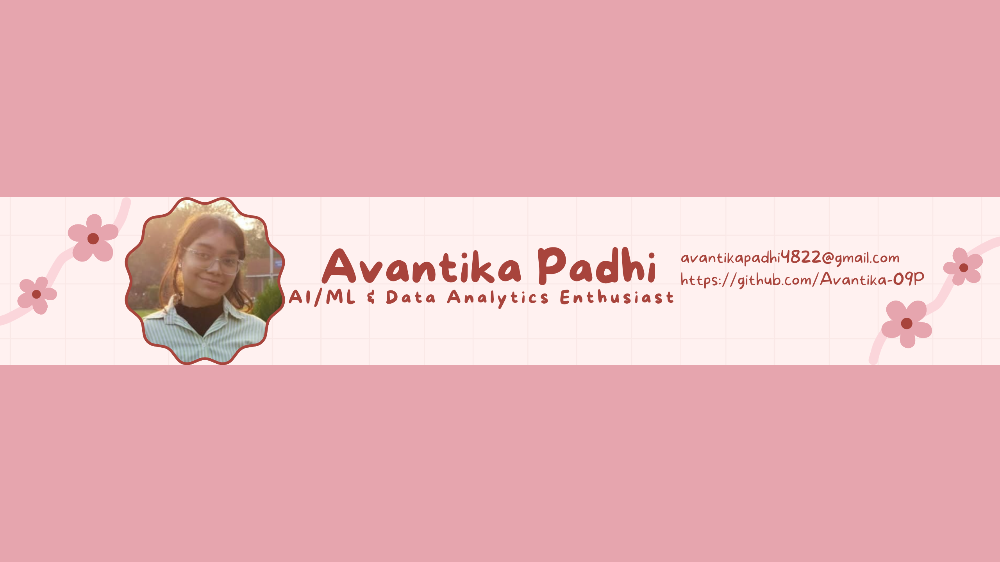

<h1 align="center">Hi 👋, I'm Avantika Padhi</h1>

<h3 align="center">AI/ML & Data Analytics Enthusiast | Computer Science Undergraduate</h3>

  Exploring Artificial Intelligence, Machine Learning, Deep Learning, Data Science, and Quantum Machine Learning.

### 👩‍💻 About Me

- 🎓 Pursuing **B.Tech in Computer Science & Technology** at ADGIPS, GGSIPU.
- 🔬 Former Student Intern at **DRDO – SAG**, working on Quantum Machine Learning, Deep Learning, and research.
- 🤖 Interested in **Artificial Intelligence, Machine Learning, Deep Learning, and Quantum Computing**.
- 📊 Exploring Data Analytics, Statistical Analysis, EDA, and Data Visualization.
- 🏦 Developed an **ANN-based Customer Churn Prediction & Risk Analysis** project.
- 🧠 Currently exploring Agentic AI and intelligent data analysis applications.
- 👨‍💻 Explore my projects: [GitHub Repositories](https://github.com/Avantika-09P?tab=repositories)
- 📫 Reach me at **avantikapadhi4822@gmail.com**

### 🛠️ Technical Skills

  
  
  
  
  
  
  
  
  
  
  
  

**Areas of Interest:** Machine Learning | Deep Learning | Data Analytics | Quantum Machine Learning | Agentic AI

### 🚀 Featured Projects

- **[ANN-Based Customer Churn Prediction & Risk Analysis](https://github.com/Avantika-09P/ANN-Classification-Churn)** – Neural network-based customer churn prediction, risk segmentation, and SHAP explainability.
- **[Agentic Data Analyst](https://github.com/Avantika-09P/Agentic-Data-Analyst)** – AI-powered data analysis application for automated data exploration, statistical analysis, and interactive visualizations.
- **AI-Based QKD Attack Detection** – Research-oriented implementation of classical and quantum machine learning models for multi-class attack detection.

### 📊 GitHub Statistics

  

  

  

### 🤝 Connect With Me

  
  

---

  <i>Learning, building, researching, and turning ideas into intelligent solutions. 🚀</i>

